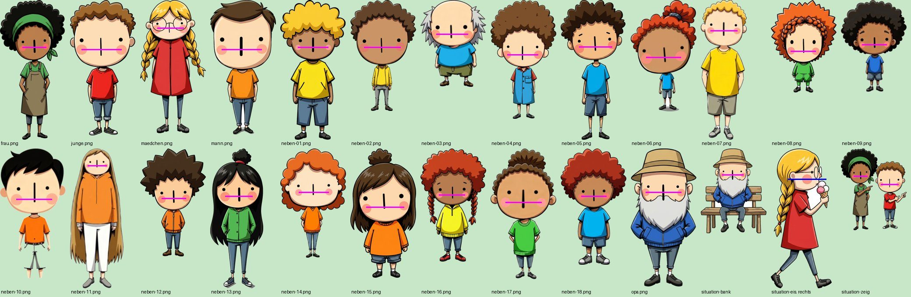
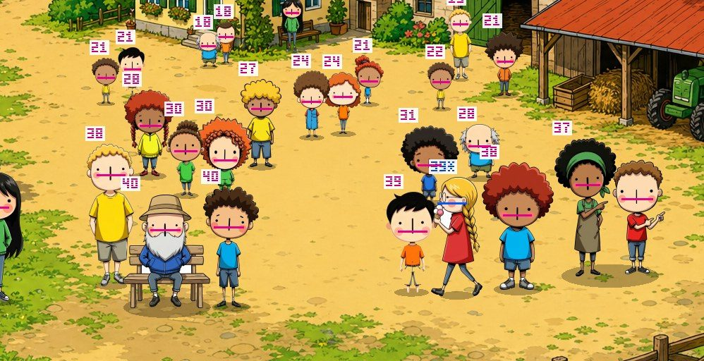

# B2.2 Collage-Prototyp Runde 2 — Rückmeldung (28.10.2026)

Auftrag: `docs/auftrag-b2-2-collage-runde2-2026-10-28.md`. Ein Commit, nichts gepusht. Nur `dev-tools/` (plus diese Rückmeldung), kein Produktcode, keine npm-Pakete.

**Runde 2 ist ein eigenes Werkzeug:** `dev-tools/collage-prototyp/collage-runde2.js`. Es baut auf deinem Runde-1-Lauf (`dev-tools/ausgabe/collage-2026-10-28-20-21.json` + Ordner) auf und verwendet Hintergründe, Helden, Situationen und die 18 Nebenfiguren **direkt aus den freigestellten PNGs von Runde 1** – kein Neuzeichnen, kein Regal-Zugriff, kein `ADMIN_SCHLUESSEL`. `collage.js` (Runde 1) bleibt unverändert lauffähig.

## Aufruf

```bash
cd ~/Developer/wimmel-wizzard-web

# 1. Plan + Kosten; dazu V1/V4/Kontrolle mit Platzhalter-Posen (Vorderansichten) – 0 $
TROCKEN=1 node dev-tools/collage-prototyp/collage-runde2.js

# 2. Der echte Lauf (17 Posen + V2/V3 für H1)
FAL_KEY=... node dev-tools/collage-prototyp/collage-runde2.js
open dev-tools/ausgabe/collage-r2-*.html

# 3. Neu würfeln / nach Zonen-Änderung neu platzieren – 0 $
NUR_V1=1 PLATZ_SEED=7 node dev-tools/collage-prototyp/collage-runde2.js
```

Schalter: `NUR=H1,H3`, `DICHTE=30`, `PAAR=0.45` (Anteil Paare), `PLATZ_SEED=…`, `RUNDE1=dev-tools/ausgabe/collage-….json` (Standard: jüngster Runde-1-Lauf), `QUALITAET` (V2).

## Kosten

| Posten | Anzahl | ca. |
|---|---|---|
| Posen (nano-banana-2/edit) | 17 | 1,36 $ |
| V2 H1 (gpt-image-2/edit, high) | 1 | 0,20 $ |
| V3 H1 (nano-banana-2/edit) | 1 | 0,08 $ |
| **Summe** | | **≈ 1,64 $** |

17 statt 18 Posen: „Frau 11“ (bodenlange Haare, winziges Gesicht – Wangenabstand 13 % der Figurenhöhe statt 16–33 %) würde bei gleich großen Köpfen zur Riesin; sie bleibt draußen, der Kontaktbogen sagt das oben. Posen werden zusätzlich freigestellt lokal abgelegt (`dev-tools/ausgabe/collage-r2-posen/`), jeder weitere Lauf kostet 0 $ (V2/V3 ebenfalls aus dem Zwischenspeicher, solange V1 gleich bleibt).

## 1. Skalieren nach Kopf — Messverfahren

**Kopfmaß = Abstand der beiden Wangen-Bäckchen** (Mitte zu Mitte, `kopf.js`), nicht die Kopfhöhe über den Umriss.

- **Warum:** Jede WizzelWim-Figur hat zwei rosa Bäckchen (in jedem Figuren- und Edit-Prompt verlangt). Ihr Abstand hängt nur an der Gesichtsgröße – Afro, Dutt, Hut, Vollbart, Kopftuch, lange Haare verfälschen jede Umriss-Messung um 30–60 %. Die Runde-1-Figuren liegen mit diesem Maß bei 16–33 % der Figurenhöhe – genau der Unterschied, den du gesehen hast.
- **Ablauf:** Pixel in Wangenfarbe (Lachs/Rosa) im oberen Teil → abtragen (der zweite Hautschatten hat oft dieselbe Farbe, ist aber nur ein schmales Band und verschwindet; das runde Bäckchen bleibt) → Flecken, durch Brillenrand getrennte Teile zusammengefasst → Paare auf gleicher Höhe, Haut dazwischen → unterstes großes Paar (Brille/Haarschleife liegen höher).
- **Ohne Paar:** Profil (eine Wange) = Fleckbreite × Verhältnis derselben Person von vorne; Rücken = Kopfbreite samt Haar × Verhältnis derselben Person von vorne. Steht im JSON als `methode` und im Kontrollbild mit `*`.
- **Ergebnis auf allen 26 Runde-1-Figuren:** 25 per Wangenpaar richtig gefunden (auch Brille, dunkle Haut, Vollbart, Hut, die Zweiergruppe), Mädchen mit Eis (Profil) über die eine Wange.



- **Ziel je Tiefe:** `kopf` je Hintergrund in `zonen.js` – Wangenabstand als Anteil der Bildhöhe, linear zwischen zwei Fußhöhen, **für alle Figuren gleich**; Kinder und Erwachsene unterscheiden sich nur in der Körperlänge. Zimmer im Querschnitt haben einen festen Wert (Tiefe der Hausfront). Toleranz ±10 % wird je Bild geprüft (`pruefung.kopfToleranz`). Weil skaliert wird, um das Maß zu treffen, ist die eigentliche Unsicherheit die Messung selbst.
- **Kontrollansicht:** eigene Spalte „Kontrolle Kopfmaß“: Wangenlinie in Magenta (gemessen) bzw. Blau (geschätzt) und die Pixelzahl über jeder Figur.



**Bekannte Grenze:** In der Zweiergruppe „Frau + Junge (zeigen)“ hat die KI die beiden Köpfe ungleich groß gezeichnet (169 / 222 px). Ein gemeinsames Bild lässt sich nur einmal skalieren → Mittelwert, je Kopf ±14 %.

## 2. Weniger „aufgeklebt“

- **Posen:** je Nebenfigur eine zweite Ansicht per `nano-banana-2/edit`, reihum *von der Seite gehend* (4), *von hinten* (4), *etwas tragend* (3: Korb, Ball, Gießkanne, Brötchentüte), *sitzend auf Bank, Dreiviertelansicht* (3), *sich bückend* (3). Edit-Satz wie Stufe 2 bzw. die Helden-Situationen (Gesicht, Bäckchen, Kopfgröße, Proportionen, Kleidung bleiben; Rücken ohne Gesichts-Teil). Prompts stehen im Kontaktbogen je Figur.
- **≤ ⅓ frontal:** Auswahl je Bild = alle Posen, dann Vorderansichten nur bis ⅓ (Personen gezählt, die Zweiergruppe zählt 2), dann Wiederholungen (gespiegelt, nicht neben derselben Person). Findet eine Pose keinen Platz, fallen zuletzt gesetzte Vorderansichten weg – die Regel hält immer.
- **Blickrichtung/Paare:** Seitenansichten werden gespiegelt, damit Paare einander anschauen (`PAAR=0.45`); Seitenansichten der Helden schauen ins Bild. Blickrichtung im Profil wird gemessen (Kopfseite mit mehr Hautfarbe), sonst gilt „facing left“ aus dem Prompt.
- **Zonen-Typen** `gehen` / `stehen` / `sitzen` / `wasser-ufer` in `zonen.js`; Posen nur in passende Zonen (Rücken bevorzugt am Wasser, Sitzende mit Bank nur auf ebenem Boden). Zusätzlich muss jetzt die **ganze Fußbreite** in der Zone stehen – damit niemand halb auf Wasser, Mauer, Beet oder Kübel steht.
- **Zonen nachgezogen:**
  - H1: Weg unten neu (stand in Runde 1 auf Steinen/Gras), Promenade unter die Ufermauer, Café zwischen den Tischen.
  - H2/H3: nach den echten Bildern eingemessen.
  - H3 zusätzlich: Terrasse vor dem Tisch, Pflaster, Einfahrt, Gehweg, Sandkasten, Garten links/rechts, Zimmer oben Mitte und rechts, Wohnzimmer, Wintergarten.
- **Dichte:** Ziel 30 Figuren je Bild, Helden genau einmal. Mit Platzhaltern hier: H1 26–29, H2 28–30, H3 27–30 (H1 hat am wenigsten Boden). Nebenfiguren dürfen sich bis 30 % verdecken, Helden weiter höchstens 20 %.

## 3. Einbetten

- **V4 „Code-Schatten“ (0 $):** weicher Bodenschatten (zur Mitte dunkler, Rand verläuft), versetzt in Richtung `sonne` je Hintergrund. Dazu leichte Farbangleichung an das Bildlicht (Tonwert um wenige Prozent zum Bild-Mittel, Sättigung −5 %) und nach hinten zunehmend ein Hauch Luftdunst (bis 10 % Richtung Umgebungsfarbe).
- **V2/V3** nur noch für H1, aus Runde 2 V1.
- Hinweis zum Stil: Die Stil-Karte verlangt Schatten mit harter Kante. V4 setzt bewusst dagegen einen weichen Schatten, wie im Auftrag – im Vergleich mit V1 (harter Schatten wie Runde 1) entscheidest du nach Augenmaß.

## Ausgabe

`dev-tools/ausgabe/collage-r2-<datum>.html`, Spalten:
- Hintergrund
- Runde 1 V1
- **Runde 2 V1**
- Runde 2 V4
- Kontrolle Kopfmaß
- nur H1: V2 und V3

Darunter alle Figuren mit Pose, Blickrichtung, Kopfmaß und Prompt.

Im JSON stehen je Figur: Pose, frontal, gespiegelt, Blick, Paarpartner, Zone, Fuß, Box, Kopfmessung (Verfahren, Sprite-Maß, Ziel, Skala) und je Bild eine Regelprüfung (Helden genau einmal, Beschnitt, Falz, Hälften, frontal-Anteil, Paare, Kopf-Toleranz, nicht platziert).

## Hier getestet (ohne fal)

- Mit den **echten** Runde-1-Figuren und -Hintergründen (von deinem Mac geholt) und einer fal-Attrappe für die Posen (liefert gespiegelte Vorderansichten).
- **Voller Lauf:** 18 nano-banana- und 1 gpt-Aufruf (17 Posen + V3, V2), 1,64 $.
- **`NUR_V1=1`:** 0 Aufrufe, 0 $. `TROCKEN=1` ebenso.
- **Mehrere Seeds:** jedes Mal 5 Helden je einmal, Falz frei, im Beschnitt, frontal ≤ ⅓, 0–6 Paare je Bild.

**Was ich nicht prüfen konnte:**
- Wie die echten Posen aussehen und ob nano-banana die Kopfgröße hält.
- Ob die Blickrichtung „facing left“ eingehalten wird.

Beides misst und zeigt das Werkzeug: Kopfmaß je Pose, Blick, Kontrollspalte. Eine Pose, deren Messung völlig aus dem Rahmen der Vorderansicht fällt, wird über die Vorderansicht geschätzt und im JSON markiert.

## Offene Punkte

1. **Sitzende Nebenfiguren** finden auf H1/H3 oft keinen Platz (Bank im Sprite ist breit, Sitz-Zonen sind klein) – dann fehlen 1–3 Figuren. Falls dich das stört: mehr `sitzen`-Flächen in `zonen.js` oder ein Sitz-Prompt ohne Bank (auf Mauer/Wiese).
2. **Kopf-Zielwerte** (`kopf` in `zonen.js`) habe ich gegenüber Runde 1 etwas kleiner gesetzt (mehr Gewimmel, H3 näher an der Türhöhe). Wenn dir die Köpfe insgesamt zu klein/groß sind: zwei Zahlen je Hintergrund, dann `NUR_V1=1`.
3. **Kontrolle über Augenmaß:** Die ±10 % gelten für die Messung. Ob Bäckchen ein guter Stellvertreter für „Kopf“ sind, siehst du in der Kontrollspalte am schnellsten.
