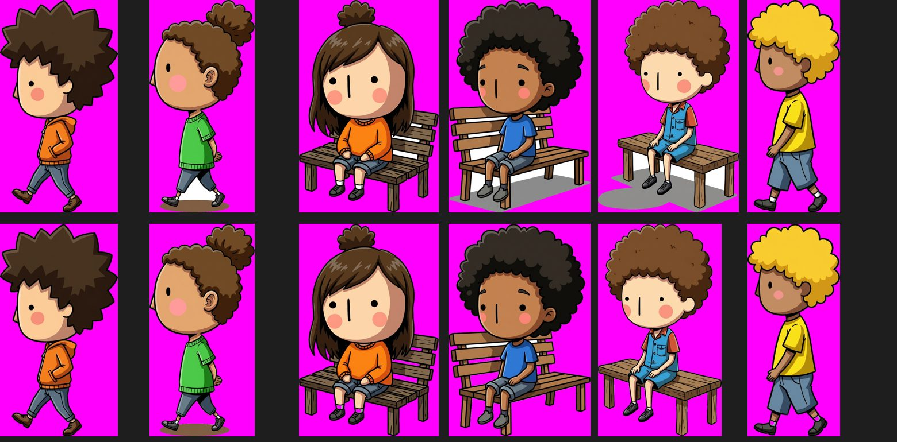

# B2.3 Collage-Prototyp Runde 3 — Rückmeldung (28.10.2026)

Auftrag: `docs/auftrag-b2-3-collage-runde3-2026-10-28.md`. Ein Commit, nichts gepusht. Nur `dev-tools/` + diese Rückmeldung, kein Produktcode, keine npm-Pakete.

## Was sich geändert hat

- **Neu: `dev-tools/collage-prototyp/collage-runde3.js`.** Baut auf Runde 1 (Figuren, Hintergründe) und deinem Runde-2-Lauf von 21:37 auf (Posen, V4 als Vergleich). Platzierung, Kopfmaß und V4 sind dieselben wie in Runde 2.
- **`collage-runde2.js`** gibt jetzt seine Bausteine an Runde 3 weiter. Die V4-Werte sind dort als Konstanten `V4_STUFEN` herausgezogen. Runde 2 rechnet unverändert, mit identischer Platzierung.
- **`bild.js`** hat neu: `loecherEntfernen` (Ersatz-Freistellen) und `aufFarbe` (Prüfbild).

## Aufruf

```bash
TROCKEN=1 node dev-tools/collage-prototyp/collage-runde3.js   # Plan + Kosten; Bilder mit Ersatz-Freistellen und den Runde-2-Posen, 0 $
FAL_KEY=... node dev-tools/collage-prototyp/collage-runde3.js  # echter Lauf
NUR_V1=1 node dev-tools/collage-prototyp/collage-runde3.js     # nur Zwischenspeicher, 0 $ (z. B. andere PLATZ_SEED)
open dev-tools/ausgabe/collage-r3-*.html
```

Weitere Schalter:
- wie in Runde 2: `NUR`, `DICHTE`, `PAAR`, `PLATZ_SEED`, `RUNDE1`
- neu: `RUNDE2=…` (Standard: jüngster echter Runde-2-Lauf)
- neu: `FREISTELLEN=ersatz` (BiRefNet überspringen)

## Kosten (Trockenlauf, Richtwerte)

| Posten | Anzahl | ca. |
|---|---|---|
| Seitenansichten neu (nano-banana-2/edit) | 7 | 0,56 $ |
| Prüfung Seitenansicht (gemini-2.5-pro über fal) | 7 | 0,14 $ |
| Freistellen BiRefNet | 43 | 0,21 $ |
| **Summe** | | **≈ 0,92 $** |

Fallen alle 7 Seitenansichten durch und werden einmal neu gezeichnet: höchstens ≈ 1,65 $. Ziel war unter 2 $.

BiRefNet rechnet fal nach Rechenzeit ab. Die Modellseite zeigt keinen Bildpreis, deshalb habe ich 0,005 $ je Figur bewusst hoch angesetzt. Die echten Zahlen stehen im fal-Dashboard. Die Prüfung kostet etwa 0,02 $ je Aufruf (Wert aus `dev-tools/aufloesung-2k-test.js`).

Alles wird zwischengespeichert:
- freigestellte Figuren in `dev-tools/ausgabe/collage-r3-figuren/`
- Prüfergebnisse in `collage-cache.json`

Ein zweiter Lauf kostet 0 $.

## 1. Freistellen mit BiRefNet

- **Was:** `fal-ai/birefnet/v2` für **alle** Figuren: 5 Helden, 3 Situationen, 17 Nebenfiguren und 17 Posen, jeweils aus der Original-URL mit weißem Grund.
- **Einstellungen:** Modell „General Use (Heavy)“ (laut fal-Doku das genauere), Arbeitsauflösung 2048 für scharfe Kanten, `refine_foreground` an. Lehnt fal 2048 für dieses Modell ab, versucht das Werkzeug 1024 und schreibt es dazu.
- **Ersatz, falls BiRefNet Konturen anfrisst:** Das Werkzeug zählt die schwarzen Konturpixel, die die Farbschwelle behält, BiRefNet aber entfernt. Sind es mehr als 3 % (`KONTUR_MAX`), greift der Ersatz:
  - Farbschwelle wie bisher;
  - dazu jede eingeschlossene **reinweiße** Fläche ab ~0,04 % der Bildfläche entfernen, außer sie berührt das Gesicht (Box um die Bäckchen);
  - dazu der **graue Bodenschatten**, den das Bildmodell unter Bank und Füße malt (breit, unten, neutral grau) – wir zeichnen unseren eigenen.
- **Nachbearbeitung:** Auch auf das BiRefNet-Ergebnis läuft noch die Loch-Entfernung, als Sicherheitsnetz.
- **Prüfbild** je Figur auf Magenta im Kontaktbogen. Dazu steht je Figur, welches Verfahren griff, wie viel Kontur weg ist und wie viele Löcher entfernt wurden.

BiRefNet selbst konnte ich nicht testen: weder Cowork noch die Shell auf deinem Mac erreichen fal.

Den Ersatz habe ich an deinen echten Runde-2-Posen getestet. Oben Runde 2, unten Ersatz: Weiß zwischen Beinen und Banklatten weg, grauer Bankschatten weg, Socken und weiße Hose von „Frau 11“ bleiben.



## 2. Seitenansichten im Stil

**Ursache:** Der Behalten-Satz aus Stufe 2 verlangt „keep the face … the dot eyes and the nose line … exactly as they are“. Damit hält er das Vordergesicht fest, und der Körper dreht sich trotzdem.

**Neu:**
- **Welche Posen:** „seite“ (4) und „tragend“ (3); beide sind Profilansichten. Rücken, Bücken und Sitzen (Dreiviertelansicht) bleiben unverändert aus Runde 2 (0 $).
- **Prompt:** der Profil-Wortlaut **wortgleich aus `pipeline.js`** (`charSheetViewPrompt`, view „side“; das Werkzeug liest ihn aus der Datei), dazu „one pink cheek only, head size unchanged“.
- **Behalten-Satz:** ohne Augen und Nase („Keep the hair, the skin tone, the head size, the body proportions, the clothing and its colors and the line weight exactly as they are.“).
- **Prüfung je Seitenansicht:** gemini-2.5-pro über fal, Aufruf wie die Figuren-Prüfung (gleicher System-Prompt, temperature 0). Frage: Augen, Bäckchen, Nase zählen, Antwort als JSON.
  - Genau 1 Auge → verwendet.
  - Sonst einmal neu, mit dem Zusatz „exactly ONE eye is visible“.
  - Fällt auch das durch → diese Person kommt als Vorderansicht ins Bild. Im Prüfbild ist sie rot umrandet, mit Zählergebnis.

## 3. V4 feinjustieren

`V4_STUFEN` in `collage-runde2.js`, jede Stufe mit Deckkraft, Länge, Angleichung, Sättigung und Dunst:

| Stufe | Deckkraft | Länge | Angleichung | Sättigung | Dunst |
|---|---|---|---|---|---|
| dezent | 0,28 | 0,14 | 0,20 | −3 % | 6 % |
| mittel (= Runde 2) | 0,42 | 0,22 | 0,35 | −5 % | 10 % |
| kräftig | 0,58 | 0,34 | 0,50 | −8 % | 15 % |

H1 bekommt alle drei nebeneinander, H2/H3 mittel. Die Werte stehen auch unter der Tabelle im Kontaktbogen. V2/V3 (KI-Einbettung) rechnet Runde 3 nicht mehr.

## Kontaktbogen

`collage-r3-<datum>.html`
- **Spalten:** Runde 2 V4 | Runde 3 V4 dezent | mittel | kräftig | Kontrolle Kopfmaß.
- **Darunter:** alle Prüfbilder auf Magenta, mit Freistell-Verfahren, Kontur-Verlust, Löchern, Kopfmaß, Augen-Prüfung und Prompt.

## Getestet (ohne fal)

- Mit deinen echten Runde-1/2-Figuren und einer fal-Attrappe: Freistellen, Profil-Edits und Prüfung, inklusive einer Seitenansicht, die zweimal durchfällt und als Vorderansicht endet.
- **Voller Lauf:** 42 BiRefNet-, 8 Edit-, 8 Prüfaufrufe. Danach `NUR_V1=1`: 0 Aufrufe, 0 $.
- **Ergebnis je Bild:** H1 24 Figuren, H2/H3 je 30. Jeweils 5 Helden genau einmal, Falz frei, höchstens ⅓ frontal.
- **H1 mit 24 Figuren** wie in deinem Runde-2-Lauf: Die Sitzenden mit Bank finden dort selten Platz.
- **Auf deinem Mac:** Runde 2 läuft nach dem Umbau unverändert. Der Trockenlauf von Runde 3 bricht dort ab, weil die Shell kein Netz hat und die Figuren-URLs nicht laden kann. Im Terminal geht das.

## Offen

1. **BiRefNet auf Strichzeichnungen** ist ungetestet. Wenn das Prüfbild ausgefranste Kanten oder angefressene weiße Kleidung zeigt: `FREISTELLEN=ersatz` (0 $). Oder in `collage-runde3.js` bei `BIREFNET.modell` „General Use (Light 2K)“ bzw. „Matting“ eintragen und `FREI_VERSION` hochzählen.
2. **Die Augen-Prüfung** zählt nur Augen. Ob Bäckchen und Nase stimmen, steht als Zahl dabei, entscheidet aber nicht.
