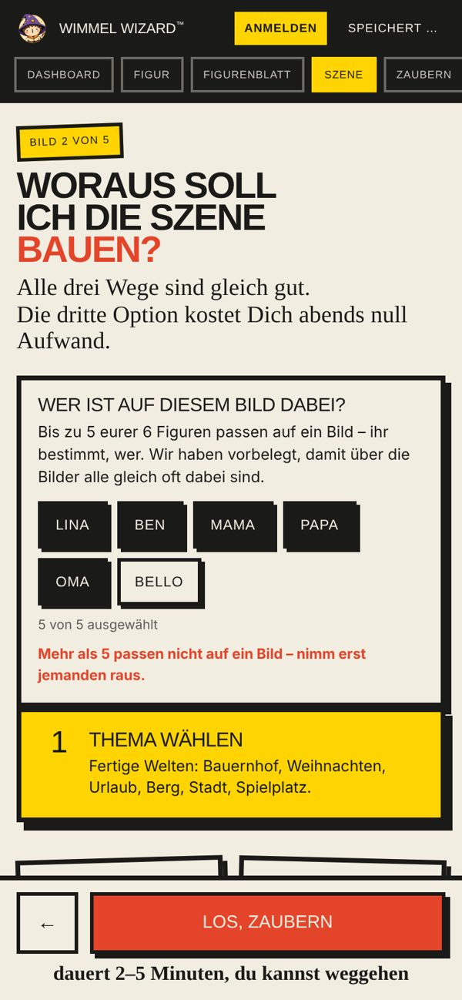
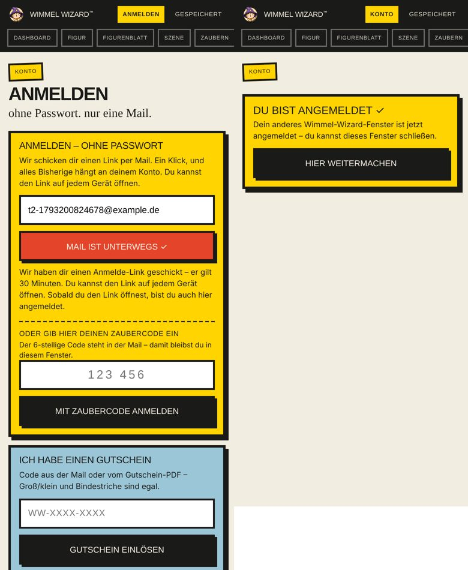
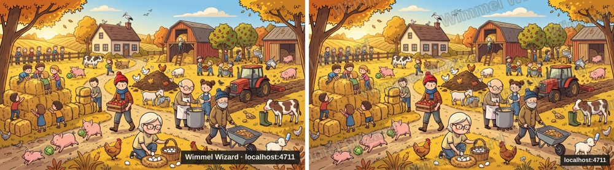
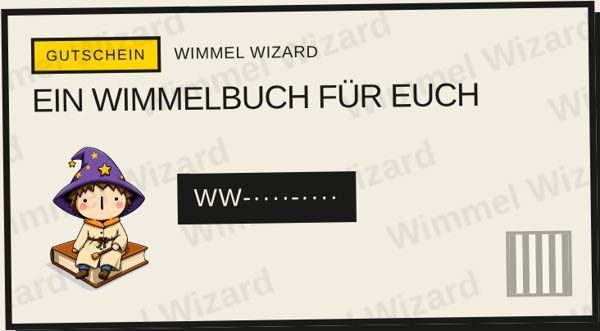

# C3.2 Mehr als 5 Helden, Anmelde-Code, echtes Wasserzeichen — Rückmeldung (28.10.2026)

Auftrag: `docs/auftrag-c3-2-helden-login-wasserzeichen-2026-10-28.md`. Drei Commits (einer je Teil) plus Rückmeldung, nichts gepusht. **Kein Prompt-Wortlaut der Bildgenerierung geändert** — Teil 1 ändert nur, welche Helden in ein Bild gehen (alles läuft weiter über dieselben `refHeroes`). `npm test`: 102/102 grün (Mac). Rauchtest je Teil (Chromium headless, 390 × 844, lokaler Server mit Attrappen).

---

## 1. Höchstens 5 Helden je Bild, mit Auswahl — Commit `f45702c`

Ursache bestätigt: `pipeline.js` nahm `heroSpecs.slice(0, 5)` — die sechste Figur fiel still weg.

- `pipeline.js`: Konstante `HELDEN_JE_BILD = 5` (ersetzt das nackte `slice(0, 5)`). Referenzbilder, Heldenbeschreibungen, Doppelgänger-Filter und Helden-Prüfung laufen wie bisher **alle** über `refHeroes` — die Auswahl steuert also alles gleichermaßen; auf nicht gewählte Helden wird nicht geprüft.
- `szene.js`: `heldenVorbelegung()` rotiert über die Bilder des Buchs (jedes fertige Bild merkt sich `heldenIds`): wer bisher am seltensten dabei war, zuerst; bei Gleichstand Kinder vor Erwachsenen; Haustier zählt als Held wie alle; dann Reihenfolge des Figurenblatts. `heldenFuerBild()` nimmt die Auswahl der Kundin (`AppState.bildHelden`), sonst die Vorbelegung. Nach jedem fertigen Bild wird die Auswahl zurückgesetzt (nächstes Bild wieder per Rotation).
- Auswahl-Schritt „Wer ist auf diesem Bild dabei?“ oben auf dem Szene-Screen, **nur** bei mehr als 5 fertigen Figuren: Figuren-Chips, max. 5 aktiv, Zähler „n von 5 ausgewählt“, beim 6. der Hinweis „Mehr als 5 passen nicht auf ein Bild – nimm erst jemanden raus.“; die letzte aktive Figur lässt sich nicht abwählen.
- Konto: „Auf jedem Bild sind bis zu 5 eurer Figuren – ihr bestimmt, wer.“ im Großfamilie-Kasten und unter den Kontingenten ab Grenze > 5.

**Rauchtest (13/13):** 6 fertige Figuren → Auswahl mit 5 aktiven (Kinder dabei, Hund als letzter draußen); 6. abgelehnt mit Hinweis; Oma raus, Bello rein; Auswahl bleibt nach Rerender; `scene-job-start` bekommt genau 5 Referenzbilder, Prompt und Prüf-Prompt nennen Bello, nicht Oma; nach einem Bild mit [Lina, Ben, Mama, Papa, Bello] ist Oma vorbelegt und die Kinder bleiben; bei 5 Figuren kein Schritt; Konto-Hinweis an beiden Stellen.

## 2. Anmelden ohne zweites Fenster — Commit `c653de2`

- Die Anmelde-Mail trägt jetzt einen **6-stelligen Zaubercode** (Betreff „Dein Zaubercode für Wimmel Wizard: 123 456“ und im Text) **und** weiterhin den Link. Gültigkeit 30 min, einmal, höchstens 5 Fehlversuche (Hinweis mit Restversuchen; danach „Bitte neuen Code anfordern“). Der Code hängt am Warte-Schlüssel der Anfrage (`anmelde-code:{w}`) — nur das anfragende Gerät kann ihn einlösen. Code-Anmeldung entwertet den Link; Link-Klick macht den Code wirkungslos. Endpunkt `POST /api/konto { mode:"anmelden-code", warte, code }` (20 je Stunde und IP), setzt das Cookie im selben Fenster.
- App: nach „Anmelde-Link schicken“ erscheint „Oder gib hier deinen Zaubercode ein“ (Ziffernfeld, Enter reicht, `autocomplete=one-time-code` für iOS-Vorschlag aus der Mail).
- **Link-Klick bei offenem Tab:** Tabs desselben Browsers reden über `BroadcastChannel("wimmel-wizard-konto")`. Der aus der Mail geöffnete Tab fragt „wer da?“ (500 ms); antwortet ein offener Wimmel-Wizard-Tab, meldet der neue ihn an (der alte lädt den Konto-Stand; das Cookie teilen sie ohnehin) und zeigt selbst nur „Du bist angemeldet ✓ – du kannst dieses Fenster schließen“ mit „Hier weitermachen“. Ohne offenen Tab wie bisher (inkl. Laden der Sitzung aus C3.1).

**Rauchtest (11/11):** Code-Feld; Mail mit Code + Link; falscher Code → „noch 4 Versuche“; richtiger Code (mit Leerzeichen, per Enter) → im selben Fenster angemeldet, ein Tab, Cookie da; Link danach „schon benutzt“; Link in neuem Tab bei offenem Tab → alter Tab angemeldet, neuer „✓ schließen“ → „Hier weitermachen“ zeigt das Konto; Link ohne offenen Tab → normaler Konto-Screen.

## 3. Wasserzeichen als Rapport — Commit `66c79a7`

- `public/js/wasserzeichen.js` (neu, eine Funktion für alle Stellen): Kachel mit zwei versetzten Zeilen „Wimmel Wizard“ in **Archivo Black** (Logo-Schrift der Landingpage, `.h-black`), Papierweiß mit Tinten-Kontur, **Deckkraft 18 %**, **−18°**, als Muster über die ganze Fläche (`anwenden(ctx, w, h)`) oder als Hintergrundkachel für CSS (`alsHintergrund(el, …)`). Stellschrauben als Konstanten: `DECKKRAFT`, `WINKEL_GRAD`, `ABSTAND_X/Y`, `KONTUR`, `GROESSE_ANTEIL` (Schriftgröße relativ zur Bildbreite), `SCHRIFT`, Farben.
- **Teilen-Bild** (`szene.js teilenBildErzeugen`): Rapport über das ganze Bild; die Adresse bleibt klein unten rechts.
- **Gutschein-Vorschau** (`/gutschein`): Rapport in Tinte, dezent (7 %), statt der einzelnen Zeile.
- **Nicht gezeichnet** wird auf gekauften Bildern und in der Druckdatei (`wasserzeichen.js` wird dort nie aufgerufen). Das **Gutschein-PDF** behält bewusst die dezente Fußzeile vom 18.10. („der Gutschein ist ein Geschenk, kein Entwurf“ — deine Entscheidung nach dem ersten Test); wenn du es dort auch als Rapport willst, ist das eine Zeile in `gutschein-pdf.js` (pdf-lib, Schrift ist eingebettet).

Vorher (Absender-Kasten, wegschneidbar) / Nachher (Rapport):

Ausschnitt in Originalgröße und Gutschein-Vorschau:

**Rauchtest (5/5):** Konstanten im Rahmen (15–20 %); Teilen-Bild als JPEG; Pixelmessung: der Rapport ist in **allen 9 Bildfeldern** messbar (mittlere Abweichung 19–22, unten rechts 43 wegen der Adresse), also nicht wegschneidbar und trotzdem dezent; Gutschein-Vorschau mit gedrehter Kachel und ohne alte Textzeile.

---

## Testanleitung (Preview)

1. **Helden:** 6 Figuren zeichnen → Szene-Screen zeigt oben „Wer ist auf diesem Bild dabei?“ mit 5 aktiven Chips (Kinder dabei). 6. antippen → roter Hinweis. Einen abwählen, den 6. wählen → Bild zaubern → nur diese 5 im Bild (und in der Helden-Prüfung). Nächstes Bild: die vorher ausgelassene Figur ist vorbelegt. Konto: Hinweis im Großfamilie-Kasten.
2. **Zaubercode:** Konto → E-Mail → „Anmelde-Link schicken“ → Mail hat Code im Betreff → Code ins Feld (oder iOS-Vorschlag) → angemeldet, kein neuer Tab. Variante: Link in der Mail antippen, während die App offen ist → der neue Tab sagt „Du bist angemeldet ✓ – Fenster schließen“, die App ist angemeldet.
3. **Wasserzeichen:** Ergebnis-Screen → „WhatsApp“/„Instagram-Story“ → geteiltes Bild zeigt den diagonalen Rapport; `/gutschein` → Vorschau mit Rapport. Druckdatei (C2-Testskript) ohne Zeichen.

## Hinweise

- `Screens.ergebnis.teilenBildErzeugen` ist für Rauchtests erreichbar (erzeugt nur die Datei, teilt nichts).
- Keine neuen Umgebungsvariablen. Datenmodell: `anmelde-code:{w}` (30 min), `images[].heldenIds`, `AppState.bildHelden`.
