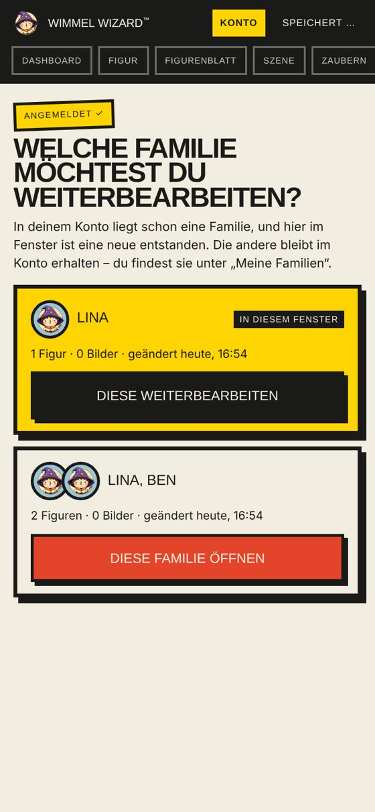
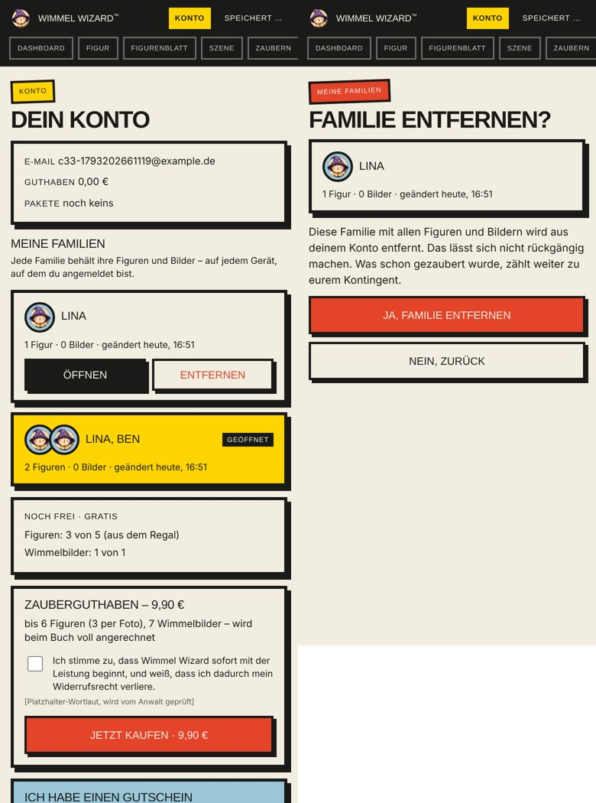

# C3.3 Die Familie gehört zum Konto — Rückmeldung (28.10.2026)

Auftrag: `docs/auftrag-c3-3-familie-im-konto-2026-10-28.md`. Drei Commits (einer je Punkt), nichts gepusht. `npm test`: 105/105 (Mac). Rauchtest: Chromium headless, 390 × 844, lokaler Server mit Attrappen (KV, Stripe, Mail, fal), **genau der Testablauf aus dem Auftrag**, 16/16.

## Befund belegt

Der Rauchtest lief zuerst gegen den Stand **vor** dem Umbau: Fenster A meldet sich an und legt Lina + Ben an; privates Fenster B meldet sich mit Code an → **keine Figuren**; Handy fordert den Link an und klickt ihn selbst → **keine Figuren**.

Ursache im Code: Code- und Link-Anmeldung hingen nur die **anfragende** Sitzung ans Konto (`anmeldeCodeEinloesen` / `anmeldeTokenEinloesen` → `sitzungVerknuepfen(sid)`) – im frischen Fenster ist das eine leere. Eine andere Sitzung des Kontos wurde nur in `handleResumeParam` geladen, und das bricht ab, wenn die angefragte Sitzung die eigene ist (C3.1-Regel für „Link auf anderem Gerät“). Deine Vermutung stimmt also.

## 1. Nach jeder Anmeldung die Familie laden — `d24eeec`

- Für alle Wege gleich (Code, Link im selben Tab, Link im neuen Tab, anderes Gerät):
  - **aktuelle Sitzung leer** → die zuletzt geänderte Familie des Kontos wird geladen (Figuren, Bilder, Entwürfe; Zähler hängen ohnehin am Konto), die leere Sitzung wird vom Konto gelöst;
  - **aktuelle mit Inhalt und eine andere mit Inhalt** → Auswahl-Screen „Welche Familie möchtest du weiterbearbeiten?“ (Vorschau, Figuren, Bilder, zuletzt geändert; die andere bleibt im Konto);
  - **aktuelle mit Inhalt, Konto sonst leer** → wie bisher anhängen.
- Vor jedem Wechsel wird der eigene Stand auf dem Server gespeichert. Bloßes Neuladen löst nichts aus. Neben-Tabs im selben Browser laden nur (nie Auswahl), damit im Hintergrund nichts aufspringt.
- Server: `familien()` und `familieEntfernen()` in `api/_lib/konto.js`, Endpunkte `mode=familien` / `familie-entfernen` in `api/konto.js`.

## 2. „Meine Familien“ im Konto — `7de9ffd`

Liste aller Familien mit Vorschau, Namen, „n Figuren · m Bilder · geändert …“; die geöffnete ist markiert. Die anderen haben „Öffnen“ und „Entfernen“, Letzteres mit Bestätigungsseite („nicht rückgängig, schon Gezaubertes zählt weiter zum Kontingent“). Die gerade geöffnete Familie lässt sich nicht entfernen (auch serverseitig gesperrt). Grundlage für das Folgebuch.

## 3. Zähler bleiben am Konto — `97ebf29`

**Bestätigt:** Figuren- und Bilder-Kontingent hängen seit C3 am Konto (`freitier:*:konto:<id>`, beim Verknüpfen übertragen). Pakete, Guthaben und Extra-Aktionen stehen im Konto-Datensatz. Der Änderungs-Deckel gilt je Familie und Figur – und eine Familie ist auf jedem Gerät dieselbe Sitzung. Familien- oder Gerätewechsel erzeugt kein neues Kontingent und verliert keins.

**Behoben:** Die Figuren-Menge zählte Personen-IDs (`lina`), die nur innerhalb einer Familie eindeutig sind. Zwei Familien mit je einer „Lina“ zählten als **eine** Figur (Rauchtest: 2 statt 3). Jetzt ist die ID `<sitzung>:<person>`; Neu-Zeichnen derselben Figur bleibt eine Figur. Entfernen einer Familie gibt kein Kontingent zurück.

**Bewusste Grenze:** Ein Fenster **ohne** Anmeldung hat sein eigenes Gratis-Kontingent (das lässt sich ohne Konto nicht verhindern). Beim Anmelden wird es mit dem Konto vereinigt; der Stand kann dann über der Grenze liegen, danach stoppt es wie immer.

## Rauchtest (16/16) – Testablauf aus dem Auftrag

(1) A: anmelden, Lina + Ben · (2) privates Fenster B mit Code → beide da · (3) Handy per Link → beide da · (4) Fenster D ohne Anmeldung „Lina“ (gleicher Name wie in A), dann anmelden → Auswahl mit zwei Karten, Familie A öffnen → da · (5) Zähler in A, B, D, Handy gleich: 3 · „Meine Familien“: zwei Familien, Öffnen wechselt, Entfernen mit Bestätigung, Stand bleibt 3 · Neuladen ohne Anmeldung: keine Auswahl · keine JS-Fehler.

## Hinweise

- Wichtig für deinen Test: Eine Familie erscheint auf dem anderen Gerät mit dem Stand ihres letzten Server-Speicherns (das automatische Speichern läuft spätestens 30 s nach der letzten Änderung). Wer im Fenster A zeichnet und **sofort** in B anmeldet, sieht A evtl. ohne die allerletzte Figur – kurz warten oder in A einmal „gespeichert“ abwarten (Anzeige oben rechts).
- Figuren, die **vor** diesem Stand gezählt wurden, tragen noch die alte ID ohne Sitzung; sie zählen weiter, nur nicht doppelt geschützt. Für die Testkonten unkritisch.
